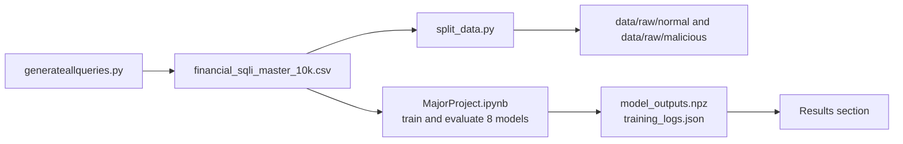
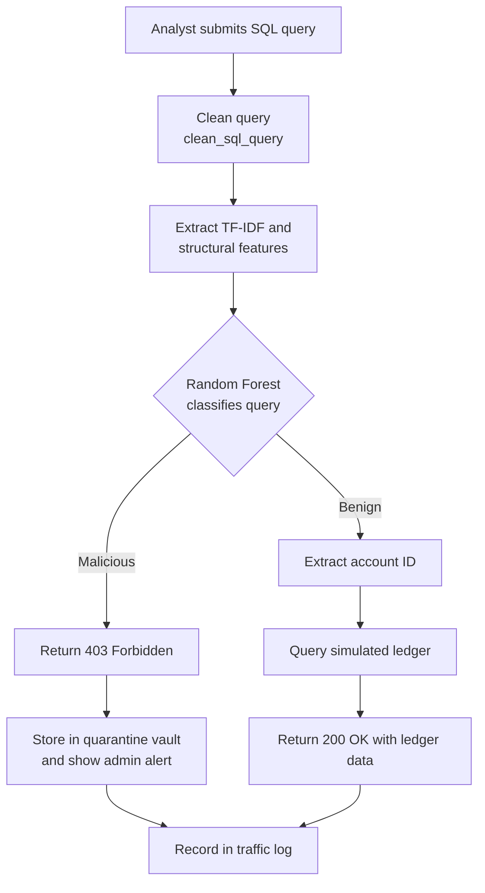
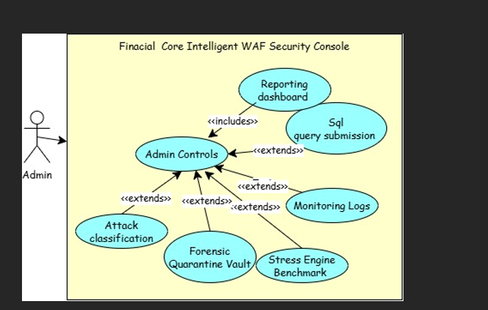
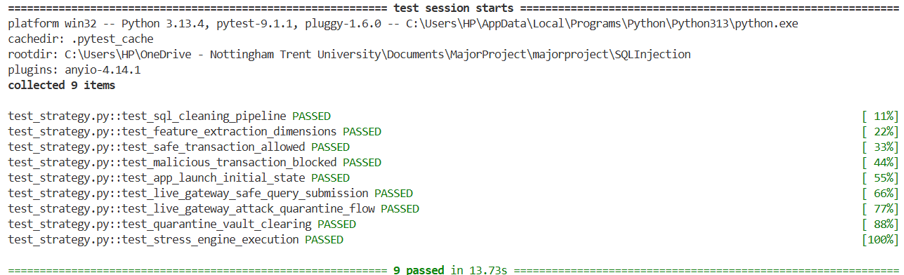
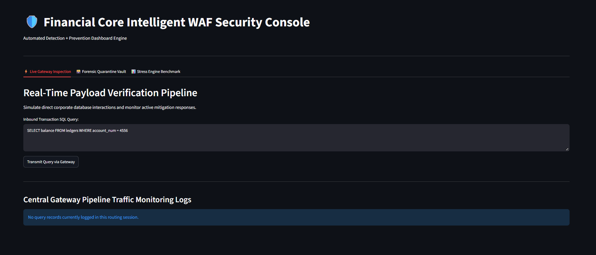
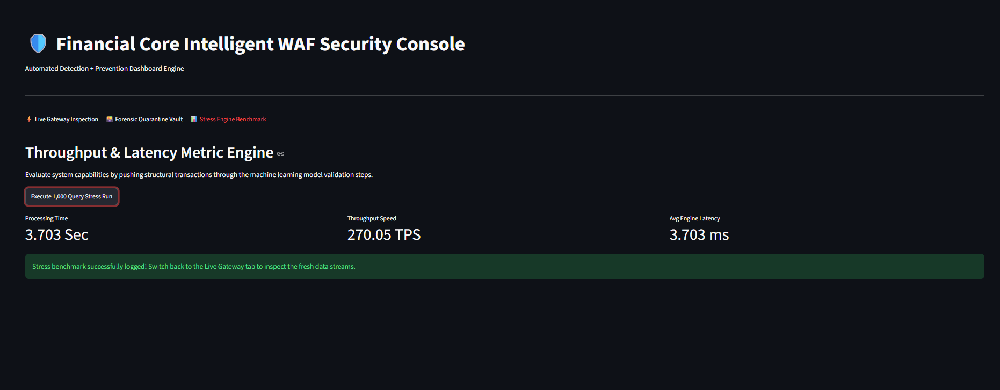

# Financial SQL Injection WAF

A Web Application Firewall prototype that detects and blocks SQL injection
attacks against a simulated banking ledger. Each incoming query is cleaned,
converted into text and structural features, and classified as normal or
malicious. Malicious queries receive a 403 response and are stored in a
forensic quarantine vault.

## Table of Contents

- [Overview](#overview)
- [Features](#features)
- [System Architecture](#system-architecture)
- [Query Inspection Flow](#query-inspection-flow)
- [Use Cases](#use-cases)
- [Dataset](#dataset)
- [Models Compared](#models-compared)
- [Results](#results)
- [Testing](#testing)
- [Dashboard](#dashboard)
- [Limitations](#limitations)
- [Project Structure](#project-structure)
- [Getting Started](#getting-started)
- [Future Work](#future-work)
- [Tech Stack](#tech-stack)
- [License](#license)

## Overview

SQL injection is one of the most common ways attackers target financial
databases. Detection models need labelled examples of normal and malicious
queries, but public datasets rarely reflect the queries a banking application
would send. This project generates a labelled dataset based on five attack
categories from my literature review, compares eight classifiers on it, and
places a classifier in front of a simulated ledger.

## Features

- Real-time query inspection through a Streamlit security console
- Automatic blocking (403) and quarantine of malicious queries
- Forensic vault for reviewing intercepted attacks
- Traffic log of every submitted query
- Built-in stress benchmark for throughput and latency

## System Architecture

The project has two stages: an offline stage that builds the dataset and
trains the models, and a runtime stage that inspects live queries.



## Query Inspection Flow

This is the path each query takes through `app.py`.



## Use Cases

The system has three actors. The application user submits queries as part of
normal banking activity. The attacker submits malicious queries. The
administrator reviews the quarantine vault, runs the stress benchmark, and
monitors traffic.



Detailed use case specifications are in
[docs/use_case_specification.md](docs/use_case_specification.md).

## Dataset

The dataset is not included in this repository. It is generated by code, so
you can recreate it locally (see [Getting Started](#getting-started)).

The generator produces 10,000 rows: 5,000 legitimate queries and 5,000
malicious queries, with 1,000 malicious queries for each of the five attack
types. Each row includes the raw query, its length, token count, structural
counts, attack type, label (`is_malicious`), timestamp, and financial context.

The queries are generated from templates, so they are highly uniform. See
[Limitations](#limitations).

## Models Compared

| Category | Models |
|---|---|
| Classical ML | Logistic Regression, SVM (linear), Random Forest |
| Deep Learning | LSTM, GRU, 1D CNN |
| Anomaly Detection | Isolation Forest, Autoencoder |

The classical models use TF-IDF features combined with seven structural
features. The deep learning models use padded token sequences. The anomaly
detection models are trained only on normal queries.

## Results

Eight models were trained and compared on a stratified 80/20 split of the
generated dataset, giving a test set of 2,000 queries (1,000 benign and 1,000
malicious). Accuracy and training time are taken from `training_logs.json`.
Precision, recall, F1, and false positive rate (FPR) are calculated from the
saved predictions in `model_outputs.npz`.

| Model | Category | Accuracy | Precision | Recall | F1 | FPR | Training time (s) |
|---|---|---|---|---|---|---|---|
| Logistic Regression | Classical ML | 1.00 | 1.00 | 1.00 | 1.0000 | 0.00% | 0.30 |
| SVM | Classical ML | 1.00 | 1.00 | 1.00 | 1.0000 | 0.00% | 0.05 |
| Random Forest | Classical ML | 1.00 | 1.00 | 1.00 | 1.0000 | 0.00% | 0.25 |
| CNN 1D | Deep Learning | 1.00 | 1.00 | 1.00 | 1.0000 | 0.00% | 3.83 |
| LSTM | Deep Learning | 0.50 | 0.50 | 1.00 | 0.6667 | 100.00% | 12.32 |
| GRU | Deep Learning | 0.50 | 0.00 | 0.00 | 0.0000 | 0.00% | 13.69 |
| Isolation Forest | Anomaly Detection | 0.50 | 0.00 | 0.00 | 0.0000 | 0.00% | 0.16 |
| Autoencoder | Anomaly Detection | 0.65 | 1.00 | 0.30 | 0.4615 | 0.00% | 2.15 |

Main findings:

- Four models (Logistic Regression, SVM, Random Forest, and 1D CNN) caught
  every attack with no false positives. The dataset is generated from
  templates with many repeated queries, so this shows the task is easy on
  this data. It does not show the detector would perform this well on real
  traffic.
- LSTM caught every attack but flagged every benign query too (FPR 100%),
  which makes it unusable for a financial ledger.
- GRU and Isolation Forest missed every attack in the test set.
- The Autoencoder caught 30% of attacks, so 70% passed through undetected.
- Classical models trained in under a second. The recurrent networks took
  about 12 to 14 seconds. These are training times, not detection speeds.

Logistic Regression was selected for deployment. Models with an FPR above 5%
were excluded first, then the remaining models were ranked by F1-score. The
live dashboard does not currently run this model. See
[Dashboard](#dashboard).

See [Limitations](#limitations) for what these results do and do not show.

## Testing

The Streamlit console and detection pipeline were tested with nine automated
tests (PyTest and Streamlit AppTest). All nine passed.

| Test ID | Test | Result | Time |
|---|---|---|---|
| TC-01 | test_sql_cleaning_pipeline | Passed | 0.02s |
| TC-02 | test_feature_extraction_dimensions | Passed | 0.03s |
| TC-03 | test_safe_transaction_allowed | Passed | 0.05s |
| TC-04 | test_malicious_transaction_blocked | Passed | 0.04s |
| TC-05 | test_app_launch_initial_state | Passed | 0.45s |
| TC-06 | test_live_gateway_safe_query_submission | Passed | 0.52s |
| TC-07 | test_live_gateway_attack_quarantine_flow | Passed | 0.50s |
| TC-08 | test_quarantine_vault_clearing | Passed | 0.58s |
| TC-09 | test_stress_engine_execution | Passed | 1.12s |



## Dashboard

The Streamlit console has three tabs:

- **Live Gateway Inspection:** submit a query and see whether it is allowed
  or blocked, with a traffic log.
- **Forensic Quarantine Vault:** review blocked queries and their structural
  indicators.
- **Stress Engine Benchmark:** run 1,000 queries through the pipeline and
  report throughput and average latency.





**Model used by the dashboard.** `app.py` does not load the model trained in
the notebook. On startup it builds its own small Random Forest on eight
hardcoded example queries, with 10 trees and a maximum depth of 5. This keeps
the app self-contained, but the dashboard's behaviour does not match the
results above. Loading the notebook-trained model is planned future work.

## Limitations

- **Synthetic dataset.** All queries are generated from templates, not
  collected from a real banking system. Classifiers may score well by
  recognising these templates rather than general attack patterns.
- **Duplicate queries.** 61.46% of the generated rows are exact duplicates of
  another row. A random train/test split can therefore place identical queries
  in both sets, which inflates the measured scores.
- **No unseen-attack evaluation.** The train/test split draws from the same
  generator, so it measures performance within a known distribution, not
  generalisation to new attack families or phrasings.
- **Evasion not tested against the trained models.** Direct testing of the
  feature layer showed that most known evasion techniques, including URL
  encoding, CHAR()-based obfuscation, boolean-blind payloads, and parenthesised
  tautologies, trigger none of the structural indicators. The trained models
  have not been evaluated against these techniques.
- **Dashboard and notebook models differ.** The dashboard runs a smaller
  Random Forest trained on eight examples. The results above describe the
  notebook models, not the live demo.
- **Simulated backend.** The "database" in `app.py` is an in-memory
  dictionary, so the 200 OK and 403 responses describe the filter's decision,
  not a production environment.
- **Small-scale benchmarks.** Throughput and latency come from one machine and
  a short run. They show relative performance, not production capacity.
- **Training time is not detection speed.** The training times measure how
  long each model took to fit. Only the dashboard's Random Forest has been
  timed on per-query inference.
- **Limited deep learning tuning.** The LSTM, GRU, and CNN were trained for
  three epochs with fixed settings. The chance-level results for LSTM and GRU
  may reflect this setup rather than the architectures themselves.
- **Testing environment.** All tests ran in a single environment. Cross-browser
  and cross-platform compatibility were not tested.
- **Not a complete WAF.** This project classifies queries. It does not provide
  rate limiting, logging pipelines, or web server integration.

## Project Structure

| File | Description |
|---|---|
| `generateallqueries.py` | Generates the labelled SQL query dataset |
| `split_data.py` | Splits the master dataset into normal and malicious sets |
| `MajorProject.ipynb` | Model training, evaluation, and analysis |
| `model_outputs.npz` | Saved test labels and model predictions |
| `training_logs.json` | Hyperparameters, training times, and accuracy for each model |
| `app.py` | Detection pipeline and Streamlit dashboard |
| `test_strategy.py` | Automated unit and UI tests |
| `requirements.txt` | Python dependencies |
| `docs/` | Use case specification |
| `images/` | Diagrams and screenshots used in this README |

## Getting Started

### 1. Clone the repository

```bash
git clone https://github.com/GeorgeNduul/DetectionOfSQLInjectionAttacksOnDatabases-Financial-Sector-.git
cd DetectionOfSQLInjectionAttacksOnDatabases-Financial-Sector-
```

### 2. Install dependencies

```bash
pip install -r requirements.txt
```

### 3. Generate and split the dataset

```bash
python generateallqueries.py
python split_data.py
```

`generateallqueries.py` creates `data/financial_sqli_master_10k.csv`.
`split_data.py` then divides it into `data/raw/normal/` and
`data/raw/malicious/`.

### 4. Run the dashboard

```bash
streamlit run app.py
```

### 5. Run the tests

```bash
pytest test_strategy.py -v
```

## Future Work

- Load the notebook-trained model in the dashboard instead of the built-in
  example model
- Test on real or public SQL injection datasets to check generalisation
- Add encoded and obfuscated payloads to the training data
- Evaluate the trained models against the evasion techniques listed under
  Limitations
- Compare results against a rule-based WAF such as ModSecurity with the OWASP
  Core Rule Set

## Tech Stack

Python, scikit-learn, TensorFlow/Keras, Streamlit, pandas, NumPy, pytest

## License

This project is licensed under the MIT License. See [LICENSE](LICENSE).